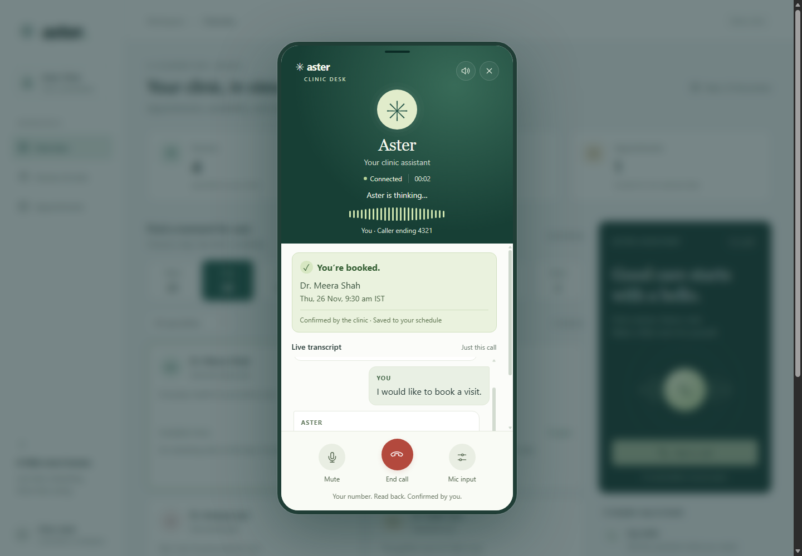
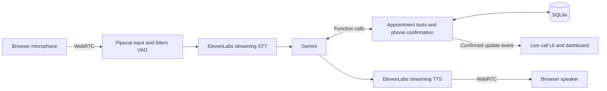

# Aster — Voice appointment assistant

Book and cancel appointments through a browser conversation. Aster combines a live clinic dashboard with Pipecat, ElevenLabs speech services, and Gemini function calling. Doctors and availability are fictional; confirmed appointments persist in a local SQLite database.



*Example call screen with fictional appointment data.*

## Features

- Four doctors, specialty and date filters, and 30-minute appointment slots across eight days.
- Spoken availability checks, booking, and cancellation using a caller-provided phone number.
- Full spoken number readback and confirmation before each appointment change.
- A phone-style call screen with connection states, timer, live transcript, waveform, mute, microphone selection, and hang-up/retry controls.
- Confirmation cards, highlighted dashboard updates, optional ring/end sounds, and responsive portrait/landscape layouts.
- Silero voice activity detection, interruption handling, and automatic call cleanup.

## Quick start

Use **Python 3.13** and Chrome or Edge on the same computer as the server. The verified full environment is Windows with Python 3.13.8. No Node.js build step or separate database server is required. Voice calls need internet access and your own ElevenLabs and Gemini credentials; the dashboard works without them.

Clone this repository and open a terminal in its root directory.

### Windows

```powershell
.\setup.cmd
if (-not (Test-Path .env)) { Copy-Item .env.example .env }
.\run.cmd
```

Open **http://127.0.0.1:8000**. Keep the terminal open; Ctrl+C stops the server. The first startup creates the database and mock schedule. Subsequent startups preserve appointments.

For voice calling, stop the server, edit `.env`, and fill in:

```dotenv
ELEVENLABS_API_KEY=
ELEVENLABS_VOICE_ID=
GOOGLE_API_KEY=
```

Use an ElevenLabs voice that your account can generate **through the API**. A voice-library preview does not establish API access. Your keys need access to the selected speech and language models and available quota.

```powershell
.\setup-voice.cmd
.\run.cmd
```

The call button enables when voice packages and the three settings are present. This readiness check does not guarantee provider access or remaining quota.

### macOS / Linux

```bash
python3.13 -m venv .venv
.venv/bin/python -m pip install -r requirements-dev.txt
[ -f .env ] || cp .env.example .env
.venv/bin/python -m uvicorn app.main:app --host 127.0.0.1 --port 8000
```

For voice, fill in `.env`, stop the server, install `requirements-voice.txt` using `.venv/bin/python -m pip install -r requirements-voice.txt`, and restart. This resolves packages for your platform; the complete voice environment has only been verified on Windows. The pinned voice snapshot is described below.

If port 8000 is occupied, run Uvicorn with `--port 8001` and open that port instead.

## Use a call

1. Click **Start a call**, allow microphone access, and wait for Aster's greeting.
2. Ask which doctors or times are available. Choose a future slot; use tomorrow if today's appointments have ended.
3. Say a fictional phone number one digit at a time when asked. Wait for the complete readback, then say **yes** or **no**. Correct a wrong number before confirming.
4. Ask to book your chosen slot. A confirmation card appears only after the server saves the appointment.
5. To cancel, use the same phone number and confirm a fresh readback. If several appointments match, select one.
6. **End call** releases the microphone and freezes the timer. **Back to dashboard** reveals the changed appointment. **Call again** starts a fresh transcript and timer.

**Mic input** opens the microphone selector and server input meter. **Mute** stops sending your speech. The speaker icon toggles only the ring/hang-up sounds, not Aster's voice. The waveform reacts to microphone audio received by the server and the assistant's incoming audio.

## Configuration

Copy `.env.example` once and keep credentials in `.env`. Restart after changing configuration.

| Setting | Default / purpose |
| --- | --- |
| `ELEVENLABS_API_KEY` | Required for voice: speech-to-text and text-to-speech access |
| `ELEVENLABS_VOICE_ID` | Required for voice: an API-accessible voice in your account |
| `GOOGLE_API_KEY` | Required for voice: Gemini access |
| `GEMINI_MODEL` | `gemini-3.5-flash-lite` |
| `ELEVENLABS_STT_MODEL` | `scribe_v2_realtime` |
| `ELEVENLABS_TTS_MODEL` | `eleven_flash_v2_5` |
| `CLINIC_TIMEZONE` | `Asia/Kolkata`; display and schedule timezone |
| `DATABASE_PATH` | `data/clinic.sqlite3`; relative paths resolve against the project root |
| `VOICE_MAX_CALL_SECONDS` | `600`; allowed range 30–1800 seconds |
| `VOICE_MAX_SESSIONS` | `2`; allowed range 1–5 |

The model names above are the configured application defaults, not a promise of account access. Ten-digit phone numbers without a country code default to `+91`; other numbers must include `+` and the country code. Stored appointment times use UTC.

### Optional provider checks

```powershell
.\.venv\Scripts\python.exe -m scripts.check_voice
.\.venv\Scripts\python.exe -m scripts.check_voice --providers
.\.venv\Scripts\python.exe -m scripts.check_voice --speech
```

The first command checks local imports, Silero, and whether settings are present. `--providers` makes read-only voice/model requests; ElevenLabs voice lookup needs Voices → Read permission. `--speech` generates a short greeting and consumes a small amount of speech quota. Add `--voice-id VOICE_ID` to test a candidate without changing `.env`. The checker reports status without printing credentials.

## How it works



FastAPI serves the frontend, appointment API, and WebRTC signaling. A WebRTC data channel sends transcripts, speaking state, input levels, appointment updates, and call-ending events. The dashboard refreshes after an appointment change and polls every five seconds while visible.

Gemini has three appointment tools: `check_doctor_availability`, `book_appointment`, and `cancel_appointment`. A fourth tool, `prepare_phone_confirmation`, starts a deterministic spoken readback. Voice mutation tools obtain the number from call-local confirmation state; the model cannot supply a confirmation boolean or substitute its own number. The readback must finish before a subsequent affirmative reply confirms it. Corrections and interruptions invalidate confirmation; a successful mutation consumes it.

`AppointmentService` owns booking and cancellation rules. SQLite transactions and a partial unique index prevent conflicting active bookings for the same slot. Calls end on hang-up, disconnect, two minutes of inactivity, or the configured duration limit.

## Project layout

```text
app/
  main.py              FastAPI routes, lifespan, static asset versioning
  config.py            Environment settings and validation
  db.py                SQLite schema and mock schedule
  models.py            Request validation and phone normalization
  services.py          Availability, booking, and cancellation rules
  voice/
    runtime.py         Pipecat pipeline and provider services
    manager.py         Readiness, signaling, call limits, cleanup
    confirmation.py    Spoken number/readback/confirmation state
    tools.py           Tool schemas and business-rule adapters
    input_audio.py     Call-local sound counters; no recordings
    errors.py          Provider error classification
  static/              HTML, CSS, JavaScript, and favicon
scripts/check_voice.py Local/provider diagnostics
tests/                 Isolated API, confirmation, and lifecycle tests
docs/PHASES.md         Milestones and manual acceptance checklist
docs/SUBMISSION.md     GitHub push and demo checklist
.github/workflows/     Automated project checks
```

## Dependencies and checks

| File | Purpose |
| --- | --- |
| `requirements.txt` | Direct dashboard dependency ranges |
| `requirements-lock.txt` | Pinned dashboard and API-test dependencies; used by `setup.cmd` |
| `requirements-dev.txt` | Includes the dashboard lock and its TestClient dependency |
| `requirements-voice.txt` | Direct voice requirements with Pipecat 1.17.0 and provider extras |
| `requirements-voice-lock.txt` | Full installed voice/test snapshot from Windows + Python 3.13.8; used by `setup-voice.cmd` |

The voice snapshot records the environment that passed the tests and live call check. It does not contain credentials, local package URLs, or wheel hashes. Its versions include packages requiring Python 3.12 or newer; use Python 3.13 to reproduce the tested setup. After intentionally changing dependencies, check compatibility and rerun tests before updating the relevant snapshot.

```powershell
.\.venv\Scripts\python.exe -m pip check
.\.venv\Scripts\python.exe -m unittest discover -s tests -v
```

Tests use temporary databases and make no live provider calls. They cover persistence, concurrency, conflicting bookings, cancellation, phone confirmation/correction, call isolation, lifecycle cleanup, diagnostic privacy, and static routes. The Pipecat import/Silero check is skipped when optional voice dependencies are absent.

If Node.js is available, check the frontend syntax:

```powershell
Get-ChildItem app/static/*.js | ForEach-Object { node --check $_.FullName }
```

The included GitHub Actions workflow runs backend tests on Linux, the full voice runtime tests on Windows, JavaScript syntax checks, and repository hygiene checks. It requires no API-key secrets. Its first hosted result will be available after pushing the repository.

Validation on 25 November 2026: **54 tests passed** with voice dependencies installed. A real provider-backed browser call using test audio completed transcription, a Gemini response, and spoken playback. A physical-microphone booking was also verified. Browser checks covered microphone switching, timer/waveform behavior, cleanup, responsive layouts, and simulated booking/cancellation confirmation events. **Manual spoken cancellation and phone-correction acceptance checks remain pending**; see [the checklist](docs/PHASES.md).

## Troubleshooting and limits

- **Call button disabled:** install voice dependencies, fill the three credential settings, and restart.
- **Microphone silent:** open Mic input, choose the correct device, check its meter and the laptop's mute key, and check Windows Sound → Input. Use localhost or HTTPS and allow browser microphone access.
- **Provider error:** check the selected voice/model's API access and quota. A working website preview or populated key does not prove API generation access.
- **Controls look stale:** reload the page. HTML is not cached; script/style URLs include content hashes.
- **No slots today:** choose another date. Elapsed slots are excluded.

This is a local, unauthenticated assignment demo, not a production clinic service. Use fictional patient information. The development HTTP booking/cancellation routes accept `phone_confirmed` for API testing; they do not enforce a spoken conversation. The voice tools enforce their separate readback gate. Remote hosting would require HTTPS, suitable STUN/TURN configuration, and an access-control design.

Keys stay server-side. Speech and text are processed by the configured external providers. The app does not persist call audio or transcripts; full normalized phone numbers remain in the local database for appointment matching. Dashboard responses mask them. Input diagnostics contain levels/counters and expire at call end.

## API and handoff

Open **http://127.0.0.1:8000/docs** for request schemas and interactive API documentation. Key routes include `/api/health`, `/api/dashboard`, `/api/availability`, `/api/appointments`, `/api/appointments/cancel`, `/api/voice/status`, and the voice offer/end routes. `/api/voice/calls/{call_id}/input` exposes temporary input counters for an active call.

`.env`, local databases, virtual environments, logs, and `.artifacts` are excluded by `.gitignore`. To try a separate empty database without deleting appointments, set `DATABASE_PATH=data/fresh-demo.sqlite3` and restart.

See [GitHub and submission steps](docs/SUBMISSION.md) for the first push and recording checklist. No repository URL or demo link is invented here; add your real video link after recording it.
